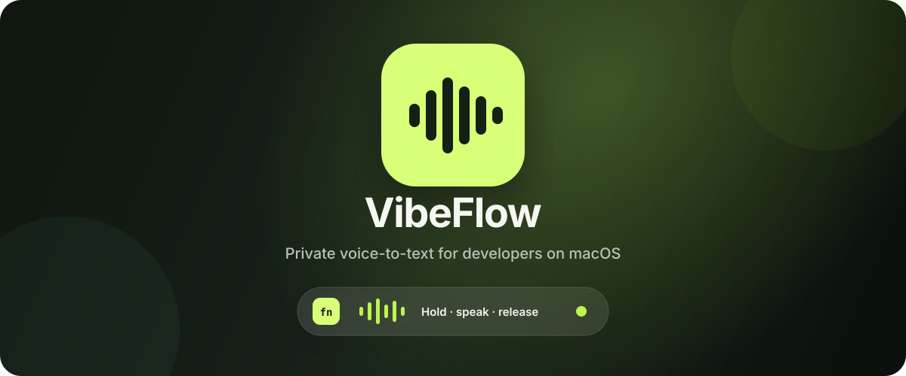

<p align="center">
  
</p>

<p align="center">
  
  
  
  <a href="https://github.com/ayshahawy-cmd/pitchkiwi/actions/workflows/ci.yml"></a>
  <a href="LICENSE"></a>
</p>

<p align="center">
  Hold <strong>Fn</strong> → speak → release. Your words appear at the cursor.<br>
  No account. No cloud transcription. No saved audio.
</p>

PitchKiwi is a native, open-source macOS voice tool for developers, vibe coders, and people who think out loud. It runs Whisper locally, removes verbal clutter with deterministic rules, and can turn a rambling request into a structured prompt without sending it to another AI model.

> [!NOTE]
> PitchKiwi is an original project inspired by the interaction pattern of modern dictation tools. It does not contain Wispr Flow source code, private APIs, branding, copy, or visual assets.

## Why PitchKiwi

| | PitchKiwi behavior |
| --- | --- |
| **Fast capture** | Hold Fn for push-to-talk, or double-press Fn for hands-free dictation. |
| **Prompt mode** | Organizes only what you said into Goal, Context, Requirements, and Done when. |
| **Smart cleanup** | Removes strong filler, repeated phrases, false starts, and explicit corrections such as “actually no” or “scratch that.” |
| **Structured speech** | Turns spoken numbered sequences into lists and understands punctuation commands. |
| **Developer aware** | Handles terms, casing commands, Markdown punctuation, snippets, and a personal dictionary. |
| **Context aware** | Optionally uses a small, bounded window around the cursor as ephemeral recognition hints. |
| **Local by design** | Whisper inference and deterministic cleanup happen on your Mac. |
| **Safe insertion** | Inserts text without pressing Return, submitting forms, or executing terminal commands. |
| **Private defaults** | Audio is never saved; transcript history and nearby-context reading start off. |
| **Native feel** | SwiftUI, AppKit, a tiny live waveform HUD, and Liquid Glass on supported macOS versions. |

## Download and install

### From GitHub Releases

1. Open the repository's [latest release](https://github.com/ayshahawy-cmd/pitchkiwi/releases/latest).
2. Download `PitchKiwi-macOS.zip` and unzip it.
3. Move `PitchKiwi.app` into your **Applications** folder.
4. On the first launch, right-click PitchKiwi and choose **Open**.
5. Follow the four-screen onboarding guide to grant Microphone and Accessibility access.

Pre-1.0 community builds are ad-hoc signed. macOS may say it cannot verify the developer; right-clicking and choosing **Open** uses Apple's normal one-app approval flow. Do not disable Gatekeeper. A future public release should use Developer ID signing and notarization.

### Build it yourself

Requirements:

- macOS 14 or newer
- Apple Silicon Mac
- Xcode 16 or newer, or matching Command Line Tools
- About 500 MB free for the framework, model, and build output

```bash
git clone https://github.com/ayshahawy-cmd/pitchkiwi.git
cd pitchkiwi
./scripts/bootstrap.sh
swift test
./scripts/build-app.sh
open ".build/PitchKiwi.app"
```

The bootstrap script downloads checksum-pinned `whisper.cpp` artifacts and the `ggml-base.en` model. The model and generated app stay in ignored local directories and are not committed to Git.

## How to use it

Choose an output mode on Home before speaking:

- **✍️ Dictate** preserves your order and voice while cleaning obvious disfluencies and repetition.
- **🥝 Prompt** applies the same cleanup, then sorts explicitly stated content into useful prompt sections. Empty sections are omitted; PitchKiwi does not invent requirements or answer the prompt.

### Push to talk

1. Click a normal text field in any app.
2. Hold the **Fn/Globe** key.
3. Speak while the small waveform moves with your voice.
4. Release Fn. PitchKiwi transcribes, cleans up, optionally structures, and inserts the text.

### Hands-free

1. Double-press **Fn**.
2. Speak without holding the key.
3. Press **Fn** once more to stop and insert.

Press **Escape** while listening to cancel. PitchKiwi never synthesizes Return/Enter, so dictated terminal commands and prompts are inserted but not executed or submitted.

> [!TIP]
> If Fn opens Emoji & Symbols, changes your input source, or starts Apple Dictation, go to **System Settings → Keyboard** and set the Fn/Globe-key action to **Do Nothing**. PitchKiwi can still observe Fn while Accessibility access is enabled.

The first transcription after launch may be slower while the model loads and Metal initializes. The current version performs transcription after you stop speaking; streaming partial results are on the roadmap. It uses beam-search decoding for stronger technical-word selection. For higher speech-recognition accuracy, import a larger compatible English Whisper GGML model from Settings at the cost of more disk space and slower processing.

After each result, **Show original** lets you compare Whisper's raw transcript with PitchKiwi's cleaned output. Cleanup remains deterministic and inspectable; it does not use a second language model or invent missing requirements.

## First-launch onboarding

The onboarding guide appears once and explains:

1. what stays on the Mac;
2. hold-to-talk and hands-free Fn gestures;
3. why Microphone and Accessibility permissions are required;
4. how to try a first prompt safely.

Completion is stored as one local macOS preference. It is not synced or sent anywhere.

## Permissions

| Permission | Why it is needed | What it does **not** enable |
| --- | --- | --- |
| **Microphone** | Captures speech only during visible dictation. | No wake word, background listening, or saved recordings. |
| **Accessibility** | Observes the Fn gesture and inserts text at the focused cursor. | Nearby-text context remains separately disabled by default. |

PitchKiwi will not begin cross-app dictation if Accessibility access is missing. If insertion fails, the transcript remains available inside the app for copying.

## Local storage and privacy

The default dictation path has no server:

```text
Microphone
   ↓  memory-only audio
Local Whisper model
   ↓  raw transcript in memory
Deterministic local cleanup
   ↓
Focused text field
```

| Data | Default | Location / lifetime |
| --- | --- | --- |
| Microphone audio | Never saved | Memory only; discarded after transcription or cancellation |
| Last transcript | Memory only | Cleared when the app quits or a new result replaces it |
| Transcript history | Off | Optional, user-selected retention in the local JSON file |
| Dictionary and snippets | Local | `~/Library/Application Support/PitchKiwi/pitchkiwi.json` |
| Usage counters | Local | Content-free totals in the same JSON file |
| Whisper model | Local | Bundled in the app or imported under PitchKiwi Application Support |
| Nearby context | Off; one job when enabled | At most 1,000 characters before and after the cursor are reduced to 40 hints and discarded |
| Onboarding completion | Local | macOS application preferences |

The JSON data file is written atomically with owner-only permissions. The app contains no account, analytics, advertising, cloud transcription, or sync integration. During the guarded paste fallback, other clipboard utilities may briefly observe the transcript; PitchKiwi restores the previous clipboard when it can.

Read the full [security and privacy design](docs/SECURITY.md) and the repository [vulnerability reporting policy](SECURITY.md). Public source code makes the implementation auditable, but it is not itself a security guarantee—review releases, checksums, permissions, and code changes before trusting sensitive dictation.

## Tech stack

| Layer | Technology |
| --- | --- |
| Application | Swift 6, SwiftUI, focused AppKit bridges |
| Audio | AVFoundation / `AVAudioEngine`, 16 kHz mono PCM |
| Speech recognition | `whisper.cpp`, local GGML model, Metal acceleration, beam-search decoding |
| Cleanup | Deterministic Swift pipeline for filler, backtracking, phrase de-duplication, punctuation, lists, and prompt structure |
| Global controls | AppKit event monitoring with Fn gesture state machine |
| Text insertion | macOS Accessibility APIs with guarded clipboard fallback |
| Persistence | Codable JSON, atomic writes, file mode `0600` |
| Packaging | Swift Package Manager and reproducible shell scripts |
| Verification | XCTest plus a real-model smoke-test executable |

## Architecture

```text
                  ┌─────────────────────────┐
Fn / Menu Bar ──▶ │ Dictation state machine │
                  └────────────┬────────────┘
                               │
        ┌──────────────────────┼──────────────────────┐
        ▼                      ▼                      ▼
  AVAudioEngine        whisper.cpp + Metal    Accessibility target
        │                      │                      │
        └──── audio ──────────▶├── text + cleanup ──▶┘
                               │
                               ▼
                    Optional local history
```

The core engine is protocol-driven so audio capture, transcription, refinement, and insertion can be tested independently. Deeper design documents:

- [Architecture](docs/ARCHITECTURE.md)
- [Product specification](docs/PRODUCT_SPEC.md)
- [Prompt architecture](docs/PROMPT_ARCHITECTURE.md)
- [Design system](docs/DESIGN_SYSTEM.md)
- [Threat model](docs/SECURITY.md)
- [Distribution and pricing](docs/DISTRIBUTION.md)

## Developer workflow

```bash
make bootstrap   # download and verify the framework + default model
make build       # debug build
make test        # run unit tests
make app         # produce .build/PitchKiwi.app
make release     # produce the app ZIP and SHA-256 checksum
```

Test the actual local model against an audio file:

```bash
swift run pitchkiwi-smoke .models/ggml-base.en.bin /path/to/speech.wav
```

Release maintainers can run `make release`, then upload both `.build/PitchKiwi-macOS.zip` and `.build/PitchKiwi-macOS.zip.sha256` to a GitHub Release.

## Repository map

```text
Sources/PitchKiwiApp/      native app, onboarding, screens, HUD, orchestration
Sources/PitchKiwiCore/     audio, Whisper, refinement, insertion, storage
Sources/PitchKiwiSmoke/    real-model command-line smoke test
Tests/                    gesture, privacy, refinement, and state tests
Assets/                   original application artwork
Packaging/                macOS bundle metadata
scripts/                  pinned bootstrap, app build, release packaging
docs/                     product, architecture, security, and UX specs
```

## Contributing

Issues and focused pull requests are welcome. Start with [CONTRIBUTING.md](CONTRIBUTING.md), preserve the privacy and non-submission invariants, and never commit recordings, real transcripts, model weights, signing secrets, or screenshots containing personal data.

PitchKiwi is available under the [MIT License](LICENSE). The name is provisional; complete a trademark and repository-name check before a broad release.
